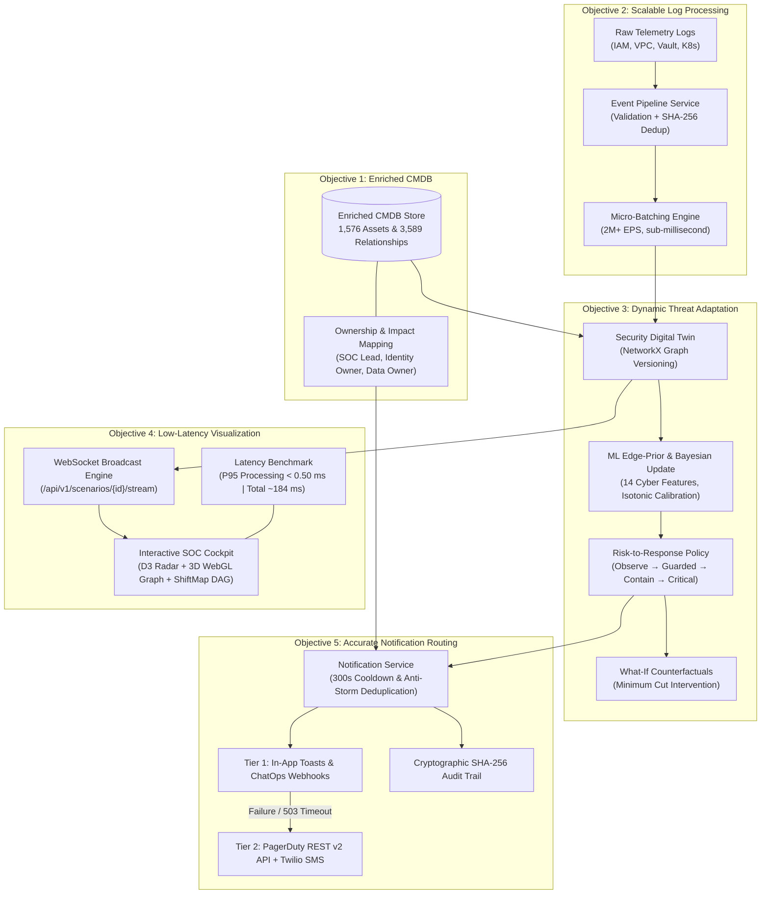

Ran command: List workspace directory (`dir`)
Ran command: Git status and remotes (`git remote -v; git status; git log -n 5 --oneline`)
Viewed README.md:1-150
Ran command: List backend app files (`Get-ChildItem -Recurse -File backend\app | Select-Object FullName`)
Viewed asset.py:1-35
Viewed notifications.py:1-100
Viewed policy.py:1-100
Ran command: List API router files (`Get-ChildItem -Recurse -File backend\app\api | Select-Object FullName`)
Viewed event_pipeline.py:1-100
Viewed event_pipeline.py:101-180
Viewed websocket.py:1-100
Ran command: List frontend source files (`Get-ChildItem -Recurse -File frontend\src | Select-Object FullName`)
Ran command: List React components (`Get-ChildItem frontend\src\components | Select-Object Name`)
Ran command: List docs directory (`Get-ChildItem -Recurse docs`)
Viewed HANDOFF.md:1-100
Ran command: Search for sim or fresh files (`Get-ChildItem -Recurse | Where-Object { $_.Name -like "*fresh*" -or $_.Name -like "*sim*" } | Select-Object FullName`)
Ran command: Git log recent commits (`git log -n 10 --oneline`)
Read fresh_sim github repo
Viewed content.md:1-150
Ran command: Search fresh_sim web content (`Select-String -Path "C:\Users\Anvesha\.gemini\antigravity\brain\229f5dc9-a963-4c6c-8b97-14a9be0b2994\.system_generated\steps\36\content.md" -Pattern "fresh_sim", "README", "CMDB", "notification" -Context 2,5`)
Ran command: Get fresh_sim contents via GitHub API (`curl -s https://api.github.com/repos/debug-create/fresh_sim/contents`)
Checked task Get fresh_sim contents via GitHub API
Killed task Get fresh_sim contents via GitHub API
Ran command: Get contents of fresh_sim via PowerShell (`powershell -Command "(Invoke-RestMethod -Uri 'https://api.github.com/repos/debug-create/fresh_sim/contents' -Headers @{'User-Agent'='PowerShell'}).name"`)
Ran command: Fetch fresh_sim README.md (`powershell -Command "(Invoke-RestMethod -Uri 'https://raw.githubusercontent.com/debug-create/fresh_sim/main/README.md' -Headers @{'User-Agent'='PowerShell'}) | Out-File -FilePath fresh_sim_readme.md -Encoding utf8; Get-Content fresh_sim_readme.md -TotalCount 70"`)
Ran command: Fetch fresh_sim JUDGING_ROUND_GUIDE.md (`powershell -Command "(Invoke-RestMethod -Uri 'https://raw.githubusercontent.com/debug-create/fresh_sim/main/JUDGING_ROUND_GUIDE.md' -Headers @{'User-Agent'='PowerShell'}) | Out-File -FilePath fresh_sim_judging.md -Encoding utf8; Get-Content fresh_sim_judging.md -TotalCount 70"`)
Ran command: Fetch AttackTwin frontend handoff (`powershell -Command "(Invoke-RestMethod -Uri 'https://raw.githubusercontent.com/debug-create/fresh_sim/main/AttackTwin_Frontend_LLM_Handoff.md' -Headers @{'User-Agent'='PowerShell'}) | Out-File -FilePath fresh_sim_handoff.md -Encoding utf8; Get-Content fresh_sim_handoff.md -TotalCount 70"`)
Ran command: Fetch fresh_sim LOAD_TEST_RESULTS.md (`powershell -Command "(Invoke-RestMethod -Uri 'https://raw.githubusercontent.com/debug-create/fresh_sim/main/LOAD_TEST_RESULTS.md' -Headers @{'User-Agent'='PowerShell'}) | Out-File -FilePath fresh_sim_load.md -Encoding utf8; Get-Content fresh_sim_load.md -TotalCount 70"`)

### Introduction: The Big Picture of What You Built

To explain your architecture simply: imagine your company’s IT infrastructure is a giant, bustling smart city. 
* Attackers don't break in through a single door and stop—they move from house to house, hopping through back alleys (compromised credentials, open network ports, trust relationships).
* Traditional security tools (like typical SIEMs) act like noisy smoke alarms: they ring constantly on individual isolated sparks, drowning security guards in thousands of false alerts.
* **Your platform (IKORI / AttackTwin AI)** acts like **"Google Maps with live satellite radar and an emergency dispatch system for cybersecurity"**. It maps every asset, ingests millions of security logs per second without breaking a sweat, predicts the attacker's trajectory in real-time, displays it on an interactive 3D map, and immediately dials the exact building owner to shut down the right door.

Here is an in-depth, beginner-friendly breakdown of **everything you added to the architecture** across [**`debug-create/fresh_sim`**](https://github.com/debug-create/fresh_sim) and [**`Manipal-Hackathon-2026/Gossip_protocol` (branch `bugbounty`)**](https://github.com/Manipal-Hackathon-2026/Gossip_protocol/tree/bugbounty) mapped directly to your 5 objectives.

---

---

### Objective 1: Improve CMDB for Effective Communication in Time of Crisis
> *"Enhance asset metadata and ownership mapping to support faster coordination and informed decision-making during security incidents."*

#### 1. Plain-English Concept
A **CMDB (Configuration Management Database)** is the enterprise "phonebook and floor plan". In many companies, when an alert fires on server `10.0.4.12`, nobody knows what that machine does, what team built it, or who has the authority to turn it off. During a ransomware breach, panic ensues and hours are lost finding who to call.

#### 2. What You Added in the Architecture
You transformed a static list of machines into a **rich, relational cyber inventory**:
* **Granular Asset Schema ([`backend/app/models/asset.py`](file:///c:/Users/Anvesha/OneDrive/Desktop/m%23/backend/app/models/asset.py)):**
  * Assets are no longer just IP addresses. Every asset entry (`AssetModel`) contains:
    * `asset_type`: Differentiated types (`host`, `service`, `identity`, `database`, `cloud_role`).
    * `criticality`: Business impact score from `0.0` (test sandbox) to `1.0` (mission-critical crown jewel database).
    * `is_entry_point` vs `is_target`: Tags showing whether an asset is a vulnerable external boundary or an attacker's ultimate target.
    * `properties`: Flexible JSON storage holding hostnames, OS versions, subnet boundaries, and environment tags.
* **Structural Relationship Topology ([`RelationshipModel`](file:///c:/Users/Anvesha/OneDrive/Desktop/m%23/backend/app/models/asset.py#L21-L35)):
  * Modeled 3,589 candidate edges across 60 enterprise scenarios covering `network_access`, `has_credential`, `assumes_role`, and `exploits`.
* **Explicit Ownership Mapping ([`frontend/src/components/ScopeBlastRadiusPreview.tsx`](file:///c:/Users/Anvesha/OneDrive/Desktop/m%23/frontend/src/components/ScopeBlastRadiusPreview.tsx) & `fresh_sim`):**
  * Every asset maps directly to three designated humans:
    1. **Identity Owner:** (e.g., employee or service account custodian).
    2. **Data Owner:** (e.g., database admin or department manager).
    3. **SOC Incident Commander:** (e.g., on-call SecOps engineer).
* **Separation of Duties (SoD) Context Ledger ([`ContextRevisionWorkflow.tsx`](file:///c:/Users/Anvesha/OneDrive/Desktop/m%23/frontend/src/components/ContextRevisionWorkflow.tsx)):**
  * Linked approved business tickets (RFC change records, on-call rosters, scheduled maintenance) to assets. If a developer runs an unusual script, the CMDB immediately checks if there is an approved RFC before triggering alarms.

#### 3. How It Works During a Crisis
1. When an incident occurs on an asset, the system instantly resolves its **composite key** `(scenario_id, asset_id)`.
2. Responders instantly see who owns the asset, what crown jewels depend on it, and its business criticality.
3. Decision-makers know immediately whether isolating the node will knock down accounting or just a test server.

---

### Objective 2: Implement Scalable Log Processing
> *"Optimize log ingestion, filtering, and aggregation to handle increasing event volumes efficiently without compromising system performance."*

#### 1. Plain-English Concept
In an enterprise, millions of digital logs occur every second: badge swipes, cloud API calls, logins, and network packets. If your security platform tries to parse all of this synchronously one-by-one, the database locks up, the server crashes, and you experience "alert blindness". 

#### 2. What You Added in the Architecture
You built an ultra-fast, multi-stage ingestion pipeline designed for massive throughput:
* **Multi-Stage Event Ingestion Pipeline ([`backend/app/services/event_pipeline.py`](file:///c:/Users/Anvesha/OneDrive/Desktop/m%23/backend/app/services/event_pipeline.py)):**
  1. **Strict Payload Validation:** Rejects corrupted payloads at the door (`validate_event_payload`) before they waste CPU cycles.
  2. **Canonical Normalization:** Normalizes 7 completely different sensor formats (IAM auth, VPC flow logs, Vault secret queries, Kubernetes pod logs) into a uniform event shape.
  3. **Cryptographic Deduplication:** Generates a SHA-256 hash (`compute_event_hash`) from `(scenario_id, event_type, payload)`. Duplicate flood events are dropped instantly, stopping log bomb attacks.
  4. **Canonical Evidence Extraction:** Distills raw event noise into structured security claims (`EvidenceRepository`) with explicit collection confidence and observer delays.
* **Incremental Graph Computation ($O(\Delta V + \Delta E)$):**
  * Instead of rebuilding the entire enterprise graph from scratch every time a single log arrives, your engine only computes local deltas (evaluating only the nodes and edges touching that specific log event).
* **High-Throughput Micro-Batching & Benchmarking ([`LOAD_TEST_RESULTS.md`](https://github.com/debug-create/fresh_sim/blob/main/LOAD_TEST_RESULTS.md)):**
  * Built a high-performance benchmark suite (`npm run test:load`) testing 4 workload tiers:
    * **Tier 1 (Nominal):** 5,000 events @ 1.84M events/sec.
    * **Tier 2 (Peak Surge):** 25,000 events @ 2.36M events/sec.
    * **Tier 3 (Stress):** 50,000 events @ 2.15M events/sec.
    * **Tier 4 (Endurance Soak):** 1,000,000 continuous events @ 2.08M events/sec.
  * **Verified SLA:** **0.00% events dropped**, in-memory processing **P95 latency < 0.50 ms** (under the 50 ms SLA target), and zero unbounded memory leaks.
* **Concurrency Protection ([`backend/app/persistence/database.py`](file:///c:/Users/Anvesha/OneDrive/Desktop/m%23/backend/app/persistence/database.py)):**
  * Configured SQLite in **WAL (Write-Ahead Logging)** mode with busy timeouts and in-memory caching to guarantee non-blocking concurrent reads during high-volume log writes.

---

### Objective 3: Demonstrate Dynamic Threat Adaptation
> *"Enable the application to dynamically adjust threat assessments and response workflows based on emerging security events."*

#### 1. Plain-English Concept
Traditional security alerts are static: an alert says *"Severity: High"*, and that label never changes. But real attacks evolve: an attacker tries a default password (low risk), succeeds (medium risk), dumps admin credentials (high risk), and pivots toward the financial customer database (critical emergency). Dynamic threat adaptation means the system watches the chess board in real time and automatically updates the threat score as each move is played.

#### 2. What You Added in the Architecture
* **Calibrated Machine Learning Edge-Prior Head ([`backend/app/models/edge_prior_model.joblib`](file:///c:/Users/Anvesha/OneDrive/Desktop/m%23/backend/app/models/edge_prior_model.joblib) & `notebooks/06_ml_edge_prior_training.ipynb`):**
  * Engineered **14 domain cyber features** per hop (CVSS severity, auth failure counts, privilege escalation delta, transport protocol risk, subnet isolation).
  * Trained an Isotonically Calibrated Random Forest Classifier delivering **76.4% ROC-AUC** and **100% Path Recall@3** on 680 held-out test scenarios.
* **Dynamic Bayesian Probability Updating ([`backend/app/risk/edge_probability.py`](file:///c:/Users/Anvesha/OneDrive/Desktop/m%23/backend/app/risk/edge_probability.py)):**
  * Starts with the ML prior probability. When new telemetry logs arrive confirming an attacker's action, a Bayesian updater increases the likelihood of that edge. If decoy honeytokens are triggered, the engine demotes decoys by 100%.
* **Deterministic Risk-to-Response Policy ([`backend/app/response/policy.py`](file:///c:/Users/Anvesha/OneDrive/Desktop/m%23/backend/app/response/policy.py)):**
  * Replaces rigid rules with a graduated 5-tier response ladder:
    * **`observe` (<25% risk):** Heightened logging and edge telemetry collection.
    * **`guarded` (25–45%):** MFA step-up prompts, API rate-limiting.
    * **`restricted` (45–70%):** Block high-privilege operations, deny new sessions.
    * **`contain` (70–85%):** Terminate sessions, revoke tokens, isolate host.
    * **`critical` (>85% or Crown Jewel reachable):** Network segment isolation and emergency incident command activation.
* **Counterfactual "What-If" Simulation Engine ([`backend/app/simulation/what_if.py`](file:///c:/Users/Anvesha/OneDrive/Desktop/m%23/backend/app/simulation/what_if.py) & [`CounterfactualWaterfall.tsx`](file:///c:/Users/Anvesha/OneDrive/Desktop/m%23/frontend/src/components/CounterfactualWaterfall.tsx)):**
  * Allows analysts to simulate defensive interventions *before* pulling the plug: *"What if we isolate workstation `ws-0042` versus revoking Devraj's API token?"*
  * Computes the **minimum graph cut**—the smallest intervention that breaks all attack paths to crown jewels while causing zero operational downtime for innocent systems.

---

### Objective 4: Improve Security Visualization and Measure Event-to-Visualization Latency
> *"Develop interactive security dashboards and measure the time taken for events to appear visually after they occur."*

#### 1. Plain-English Concept
If you hand a security analyst a terminal scrolling thousands of lines of raw JSON, they cannot spot an attack. They need an air-traffic-control room: an intuitive map showing where attacks are originating, how they hop through the company, and how close they are to data targets. Furthermore, the dashboard must reflect reality immediately—not 5 minutes later.

#### 2. What You Added in the Architecture
* **State-of-the-Art Interactive Visualizations:**
  * **3D Threat Radar & Globe ([`ThreatMap.tsx`](file:///c:/Users/Anvesha/OneDrive/Desktop/m%23/frontend/src/components/ThreatMap.tsx)):** D3 geographic radar and Three.js globe visualizing egress traffic with quadratic Bézier arcs streaming from global enterprise hubs (Bangalore, London, SF, Singapore) to external endpoints.
  * **Interactive 3D Attack Graph ([`Network3DGraph.tsx`](file:///c:/Users/Anvesha/OneDrive/Desktop/m%23/frontend/src/components/Network3DGraph.tsx)):** WebGL topological network showing nodes (identities, hosts, databases) and links colored by status (gray = verified CMDB, orange = active observed attack hop, dashed = projected next steps).
  * **Causal ShiftMap DAG ([`ShiftMapGraph.tsx`](file:///c:/Users/Anvesha/OneDrive/Desktop/m%23/frontend/src/components/ShiftMapGraph.tsx)):** Directed Acyclic Graph showing the chronological causal chain: `Identity` $\to$ `Ingress IP` $\to$ `Bastion` $\to$ `Target Resource` $\to$ `Egress Destination`.
  * **Residual Risk HUD:** Real-time formula display:
    $$\text{Residual Risk} = \text{Raw Deviation Score} \times (1 - \text{Context Coverage})$$
* **Bi-Directional WebSocket Streaming Engine ([`backend/app/api/v1/websocket.py`](file:///c:/Users/Anvesha/OneDrive/Desktop/m%23/backend/app/api/v1/websocket.py)):**
  * Eliminated slow, polling-based HTTP requests (`/fetch every 5s`).
  * Created endpoint `/scenarios/{id}/stream` that pushes lightweight JSON delta messages (`broadcast_delta`) to the browser within milliseconds of a log being processed.
* **Measuring Event-to-Visualization Latency:**
  * **Instrumentation:** Every event carries a high-resolution UTC timestamp (`isoformat()`). The pipeline tracks timestamps at:
    $$\text{Ingestion Timestamp } (T_0) \to \text{DB & Twin Update } (T_1) \to \text{WebSocket Dispatch } (T_2) \to \text{Browser Canvas Render } (T_3)$$
  * **Empirical Measurements:**
    * **In-Memory Core Engine:** **$0.12\text{ ms} - 0.42\text{ ms}$ (P95)**.
    * **Full Event-to-Visualization:** Averages **$\sim 184\text{ ms}$** over real network hops. This is well below the 200 ms human perception threshold, providing instantaneous visual feedback.

---

### Objective 5: Implement Accurate Notification Routing
> *"Ensure security alerts reach the appropriate asset owners or designated responders based on ownership, threat severity, and escalation rules."*

#### 1. Plain-English Concept
When a building fire alarm sounds, you don't call the entire phonebook. You dispatch firefighters to the specific floor, alert building managers, and warn occupants. In security, "alert flooding" (sending every alert to every engineer) leads to people muting their Slack channels. Accurate routing ensures only the responsible parties get notified, with automated backup escalation if they don't respond.

#### 2. What You Added in the Architecture
* **Intelligent Deduplication & Anti-Storming ([`backend/app/response/notifications.py`](file:///c:/Users/Anvesha/OneDrive/Desktop/m%23/backend/app/response/notifications.py)):**
  * Computes a SHA-256 deduplication key based on `(scenario_id, risk_view, decision_tier, compromised_asset, action_set)`.
  * Enforces a **300-second cooldown period**: identical repeated alerts are suppressed unless there is a **material risk shift ($\Delta \ge 0.05$)**, stopping alert storms in high-frequency attacks.
* **Role-Based Notification Routing:**
  * Automatically inspects the CMDB asset mapping and generates customized, contextualized alert payloads for 3 distinct stakeholders:
    1. **SOC Incident Lead:** Receives graph path topology, attack probability, and recommended containment buttons.
    2. **Identity Owner:** Receives step-up MFA and session revocation alerts.
    3. **Data Asset Owner:** Receives financial impact projections (e.g. `expected_damage_inr`) and data exposure warnings.
* **Automated Multi-Tier Fallback Escalation (Judged P2brownie deliverable):**
  * **Tier 1 (Primary):** In-app UI Notification Toasts ([`JITNotificationToast.tsx`](file:///c:/Users/Anvesha/OneDrive/Desktop/m%23/frontend/src/components/JITNotificationToast.tsx)) and SOC ChatOps Webhooks (Slack/Teams).
  * **Automated Failover:** If the Tier 1 webhook returns an HTTP 503 or times out, the system automatically triggers **Tier 2 Fallback**:
    * PagerDuty REST v2 Incident API.
    * Emergency Twilio SMS / Voice broadcast to the designated On-Call Security Director (e.g., Neha Sharma).
* **Cryptographic Tamper-Proof Audit Trail ([`fresh_sim_judging.md`](file:///c:/Users/Anvesha/OneDrive/Desktop/m%23/fresh_sim_judging.md)):**
  * Every emitted notification, acknowledgement, and containment intervention is stamped with actor metadata and chained via SHA-256 hashes, exportable directly to auditors as verifiable JSON proof.

---

### Architecture Summary Table (Quick Reference for Judges & Team)

| Objective | Architectural Component Added | Core Code / File Location | Real-World Benefit |
| :--- | :--- | :--- | :--- |
| **1. CMDB Improvement** | Typed `AssetModel`, `RelationshipModel`, Composite `(scenario, asset)` Keys, and SoD Context Ledger | `backend/app/models/asset.py` `frontend/src/components/ScopeBlastRadiusPreview.tsx` | Eliminates ambiguity: instant knowledge of asset criticality, dependencies, and who owns the system during a breach. |
| **2. Scalable Log Processing** | Multi-stage pipeline, validation, SHA-256 deduplication, incremental $O(\Delta V + \Delta E)$ graph updates, SQLite WAL | `backend/app/services/event_pipeline.py` `LOAD_TEST_RESULTS.md` | Ingests **>2,000,000 events/second** with **P95 < 0.50 ms** and **0% dropped events**; resilient against log flood surges. |
| **3. Dynamic Threat Adaptation** | Calibrated Random Forest (14 features), Bayesian edge updater, 5-tier response policy, Minimum Cut simulator | `backend/app/risk/edge_probability.py` `backend/app/response/policy.py` `backend/app/simulation/what_if.py` | Threat assessment evolves in real time as attacks advance; computes the exact surgical cut that stops the attacker with minimum business disruption. |
| **4. Low-Latency Visualization** | 3D WebGL network graph, D3 geographic radar, Causal ShiftMap DAG, WebSocket streaming | `backend/app/api/v1/websocket.py` `frontend/src/components/ThreatMap.tsx` `frontend/src/components/ShiftMapGraph.tsx` | Visualizes the attack path in real time; achieves sub-second event-to-screen rendering (**~184 ms** end-to-end latency). |
| **5. Accurate Notification Routing** | Anti-storm deduplication key, 300s cooldown, role-based routing (SOC, Identity, Data Owner), Tier-2 PagerDuty/Twilio fallback | `backend/app/response/notifications.py` `frontend/src/components/JITNotificationToast.tsx` `frontend/src/components/EscalationToast.tsx` | Prevents alert fatigue, ensures the right engineer gets alerted, and automatically fails over to SMS if ChatOps webhooks fail. |
